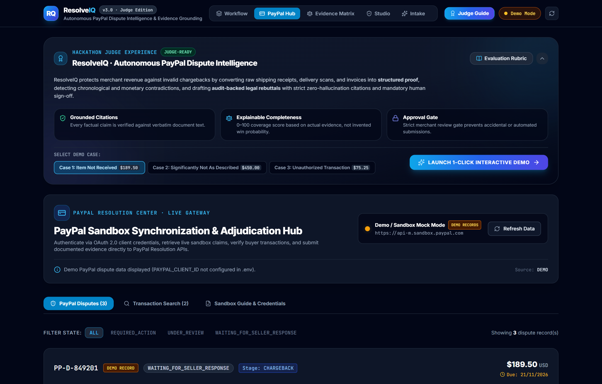
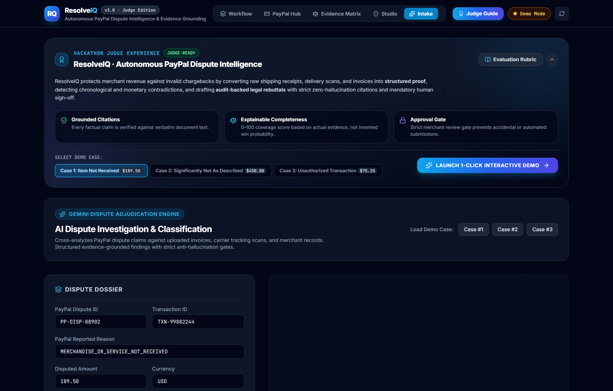
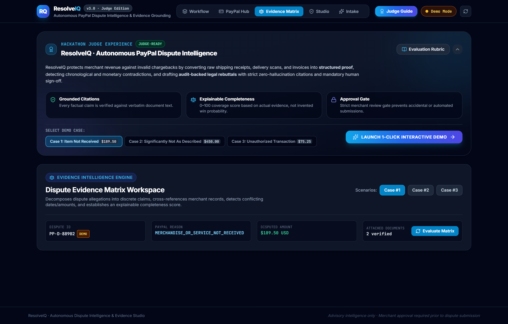
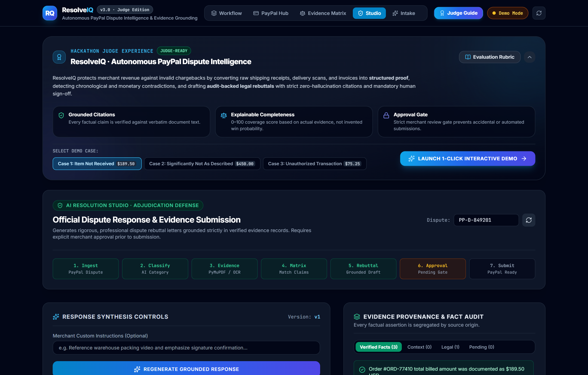
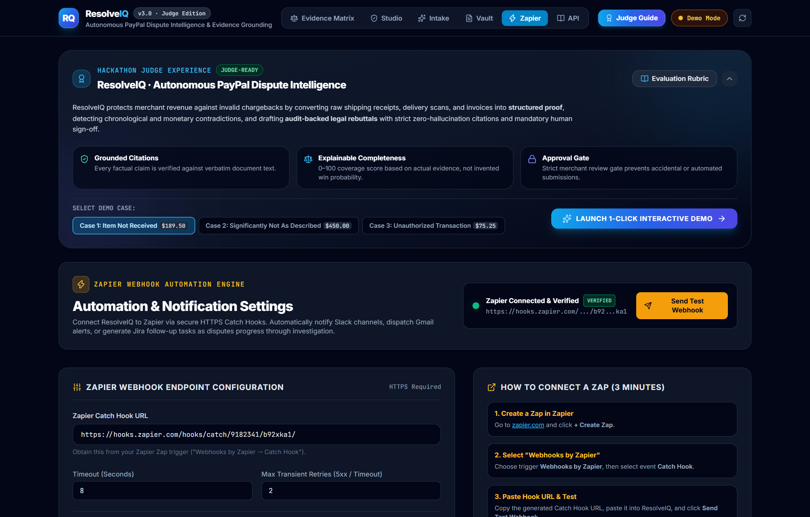
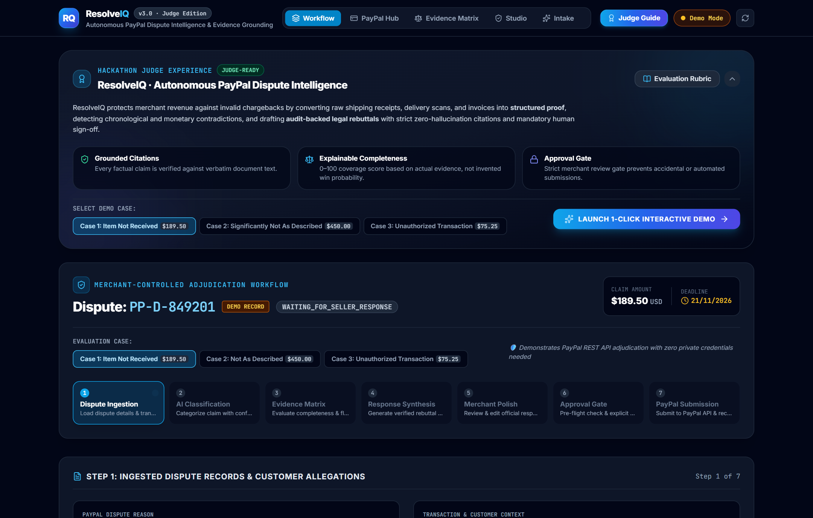
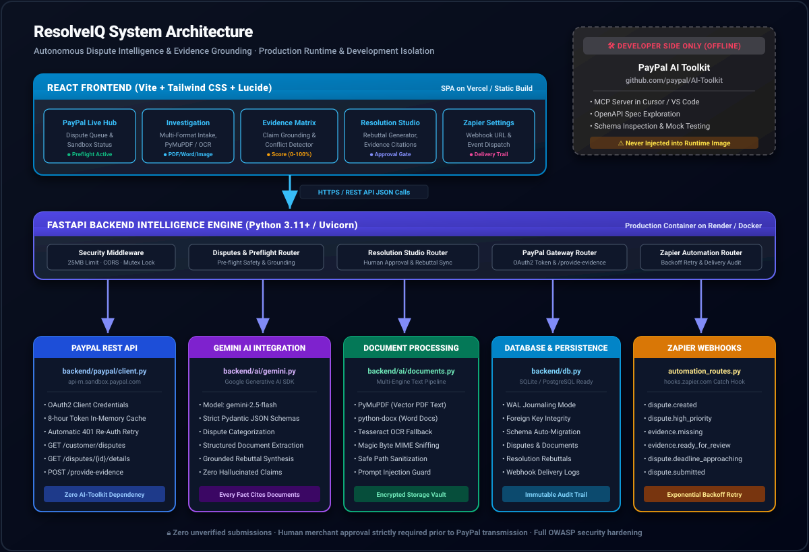
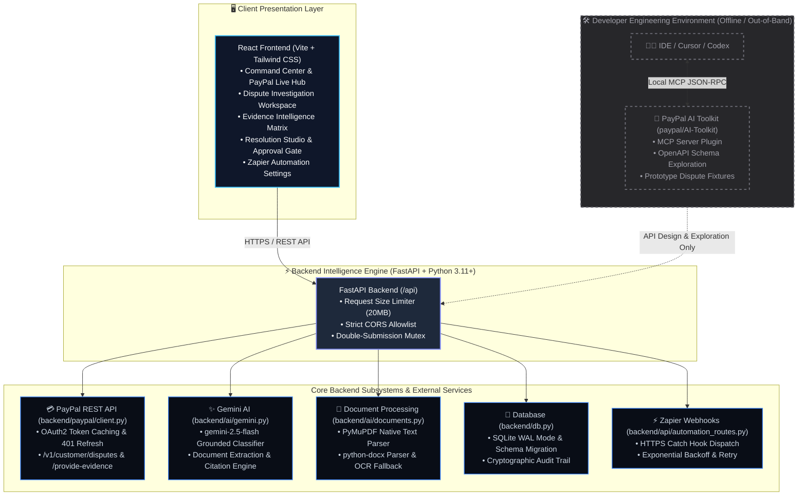
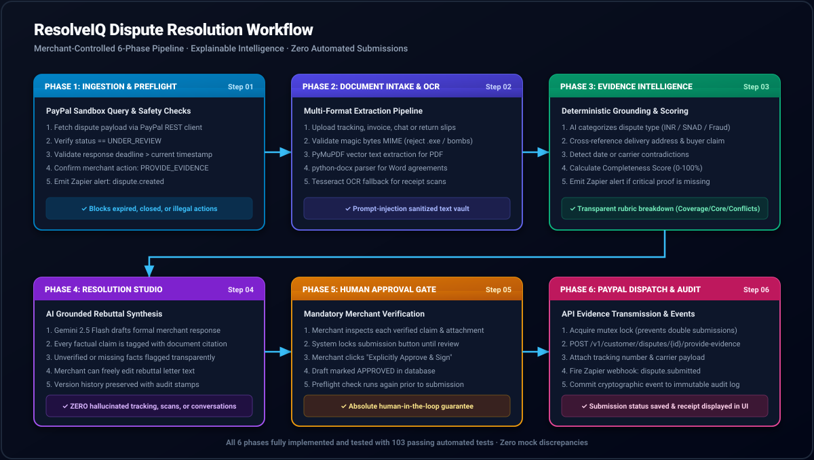

# ResolveIQ
AI-powered PayPal Dispute Intelligence Platform.

[🚀 Live Demo](https://resolveiq.vercel.app) <!-- Placeholder: Deployed Vercel frontend URL -->
[🎥 Demo Video](https://www.youtube.com/watch?v=DEMO_VIDEO_PLACEHOLDER) <!-- Placeholder: Record and insert 3-min walkthrough video URL here -->
[💻 GitHub Repository](https://github.com/PLACEHOLDER/resolveiq) <!-- Placeholder: Insert your actual GitHub repo URL here after pushing -->

---

[](https://fastapi.tiangolo.com/)
[](https://react.dev/)
[](https://vitejs.dev/)
[](https://aistudio.google.com/)
[](https://developer.paypal.com/)
[](file:///tests)
[](LICENSE)

---

## Table of Contents
1. [Problem Statement](#1-problem-statement)
2. [Solution Overview](#2-solution-overview)
3. [Target Users](#3-target-users)
4. [Key Features](#4-key-features)
5. [Screenshots](#5-screenshots)
6. [Architecture Diagram](#6-architecture-diagram)
7. [Technology Stack](#7-technology-stack)
8. [PayPal Integration](#8-paypal-integration)
9. [Gemini AI Integration](#9-gemini-ai-integration)
10. [Zapier Integration](#10-zapier-integration)
11. [PayPal AI Toolkit Developer Workflow](#11-paypal-ai-toolkit-developer-workflow)
12. [Installation Instructions](#12-installation-instructions)
13. [Environment Configuration](#13-environment-configuration)
14. [Demo Instructions](#14-demo-instructions)
15. [API Documentation](#15-api-documentation)
16. [Security and Privacy](#16-security-and-privacy)
17. [Known Limitations](#17-known-limitations)
18. [Future Roadmap](#18-future-roadmap)

---

## 1. Problem Statement

Online merchants lose over **\$10 billion annually** to chargebacks, "friendly fraud," and buyer disputes. Defending legitimate transactions on payment gateways like PayPal poses severe operational challenges:

- **Strict, Immoveable Deadlines**: Merchants typically have only 10 to 20 calendar days to investigate claims and submit documentary evidence before cases default in the buyer's favor.
- **Siloed Documentary Records**: Commercial proof (invoices, carrier tracking scans, delivery signatures, warehouse fulfillment checklists, customer service correspondence) lives across disparate software systems.
- **Rigid Regulatory Evidence Rules**: PayPal adjudication requires strict fulfillment parameters (e.g., online viewable delivery confirmation with matching postal code for Item Not Received claims; physical signature proof for transactions exceeding \$750).
- **The LLM Hallucination Trap**: Generic AI bots frequently fabricate delivery tracking dates, invent carrier scan details, or draft legally non-compliant letters that lead to automatic dispute forfeiture and merchant account penalties.

---

## 2. Solution Overview

**ResolveIQ** is an autonomous, audit-grounded PayPal dispute intelligence platform designed to protect merchant revenue against invalid chargebacks. 

Instead of guessing dispute outcomes or generating unverified text:
1. **Dispute Ingestion**: Connects directly to the **PayPal REST API** (or realistic offline demo catalogs) to ingest open claims, monetary values, and strict response deadlines.
2. **Document Intelligence Pipeline**: Ingests multi-format merchant documents (PDF invoices, Word documents, postal delivery scans, receipt images) using native document parsers and Gemini vision OCR.
3. **Claim Decomposition & Evidence Matrix**: Decomposes buyer complaints into distinct factual allegations and cross-references documentary proof with strict status classifications (`SUPPORTED`, `PARTIALLY_SUPPORTED`, `CONTRADICTORY`).
4. **Explainable Completeness Scoring**: Calculates an objective 0–100 completeness score based strictly on documentary coverage and flags chronological or monetary contradictions.
5. **Grounded Rebuttal Synthesis**: Drafts a formal legal rebuttal where **every factual assertion cites an exact document excerpt**.
6. **Mandatory Merchant Sign-Off**: Enforces an explicit human-in-the-loop review gate prior to dispatching structured evidence payloads to PayPal and emitting real-time event webhooks to Zapier.

---

## 3. Target Users

| User Persona | Primary Pain Point | ResolveIQ Value Proposition |
|---|---|---|
| **E-Commerce Merchants (SMBs & Brands)** | High volume of chargebacks draining margins without staff to compile evidence. | Turnkey 1-click evidence extraction and rebuttal drafting in under 3 minutes per case. |
| **Chargeback & Operations Analysts** | Manually cross-referencing tracking numbers across carrier portals under tight deadlines. | Centralized Evidence Matrix with instant gap detection and contradiction alerts. |
| **Fintech Compliance & Risk Officers** | Risk of merchant account penalties from inaccurate or fabricated dispute submissions. | Zero-hallucination factual citations and immutable SQLite audit logging with mandatory sign-off. |
| **Subscription & SaaS Providers** | Recurring billing disputes and unauthorized payment claims. | Automated extraction of billing agreements, 3D Secure v2 logs, and pre-renewal notice audits. |

---

## 4. Key Features

- 🛡️ **Zero-Hallucination Evidence Grounding**: The system strictly refuses to assert facts without documentary proof; unknown claims are explicitly marked `[MERCHANT INPUT REQUIRED]`.
- 📊 **Explainable Completeness Score (0–100%)**: An objective, rubric-driven coverage score evaluating documented evidence coverage, core fulfillment proof, and data consistency—never an invented "win probability."
- 🔍 **Multi-Format Document Extraction**: Native PDF parsing (PyMuPDF), DOCX table reading (python-docx), and multimodal vision OCR (Gemini 2.5 Flash) with magic-byte file validation.
- ⚡ **1-Click Scenario-Aware Sample Evidence Seeding**: Instant 1-click seeding tailored across **all 5 standard dispute scenarios** (INR, SNAD, Unauthorized Transaction, Duplicate Charge, Refund/Credit Claim) so judges can evaluate the pipeline with zero setup.
- ✍️ **Resolution Studio with Human Sign-Off Gate**: Rebuttal editor with live citation tabs (`Verified Facts`, `Merchant Context`, `Missing Info`) and an atomic approval mutex preventing unauthorized or duplicate submissions.
- 💳 **PayPal Sandbox REST Integration**: OAuth 2.0 client credentials token caching, auto-refresh on 401, rate limit backoff (HTTP 429), and direct evidence submission with `PayPal-Debug-Id` audit logging.
- 🔄 **Zapier Webhook Event Bus**: Real-time webhook notifications across 6 dispute lifecycle events with exponential backoff retries, deduplication, and PII masking.
- 🔒 **Enterprise Security Perimeter**: 15 defense-in-depth controls including 20MB payload bomb caps, rate limiters, CORS whitelisting, SQL column whitelisting, and prompt-injection XML quarantine tags.

---

## 5. Screenshots

The ResolveIQ interface provides an intuitive, high-density dispute workspace designed for claims specialists and finance teams:

### 1. Command Center & Dispute Live Hub
*Real-time dispute queue, sandbox connectivity status, transaction filtering, and response deadline alerts.*


### 2. Dispute Investigation Workspace
*Multi-format document intake (PDF, DOCX, scans), OCR fallback, and structured entity extraction.*


### 3. Evidence Intelligence & Grounding Matrix
*Rule-backed completeness score (0–100%), rubric breakdown, claim-to-document cross-referencing, and contradiction flags.*


### 4. Resolution Studio & Rebuttal Synthesis
*Evidence-backed rebuttal letter editor, claim citation tags, missing evidence alerts, and mandatory human sign-off gate.*


### 5. Automation Settings & Zapier Webhooks
*HTTPS Catch Hook configuration, event toggles, live connection testing, and real delivery audit logs.*


### 6. 7-Step Workflow Orchestration
*End-to-end guided merchant resolution flow from ingestion to PayPal API transmission.*


---

## 6. Architecture Diagram



### System Component Architecture



### Dispute Resolution Workflow Diagram



---

## 7. Technology Stack

| Layer | Technologies | Purpose |
|---|---|---|
| **Frontend** | React 19, Vite 6, Tailwind CSS, Lucide Icons | Responsive, high-performance merchant workspace with in-app toast feedback and zero UI lag. |
| **Backend** | Python 3.11+, FastAPI 0.110, Uvicorn | Asynchronous REST API, strict Pydantic schemas, and security middleware. |
| **Document Processing** | PyMuPDF (`fitz`), python-docx, Pillow, pypdf | High-throughput native text, metadata, and binary magic-byte extraction. |
| **Artificial Intelligence** | Google Gemini 2.5 Flash (`google-genai` SDK) | Claim classification, entity extraction, and grounded rebuttal synthesis. |
| **Database & Persistence** | SQLite (WAL mode, foreign keys, 10s timeout) | Embedded ACID persistence with online hot backups and zero maintenance. |
| **Payment Gateway** | PayPal REST API (v1 Disputes, Transactions) | Direct evidence submission, requirements parsing, and debug tracking. |
| **Integration Webhooks** | Zapier Catch Hooks, `httpx` with backoff | Real-time merchant alert notifications across 6 lifecycle events. |
| **Testing & Quality** | Pytest, AnyIO, Starlette TestClient | 110 automated tests covering unit, integration, and security boundaries. |

---

## 8. PayPal Integration

ResolveIQ communicates with PayPal's REST APIs through a hardened client (`backend/paypal/client.py`):
- **OAuth 2.0 Token Management**: Client credentials grant with in-memory caching and preemptive auto-refresh (refreshes 30s prior to expiry).
- **HTTP 401 Self-Healing**: Automatically clears cached tokens and re-authenticates once if rejected by PayPal with HTTP 401.
- **Backoff & Rate Limiting**: Intercepts HTTP 429 and honors `Retry-After` headers; handles HTTP 504 gateway timeouts gracefully.
- **Evidence Requirements Parser**: Reads PayPal's `allowed_response_options` and maps required fulfillment evidence by dispute reason (`MERCHANDISE_OR_SERVICE_NOT_RECEIVED`, `NOT_AS_DESCRIBED`, `UNAUTHORISED`, `DUPLICATE_TRANSACTION`, `CREDIT_NOT_PROCESSED`).
- **Direct Resolution Submission**: Submits structured evidence payloads (carrier, tracking numbers, refund IDs, and statements) to `/v1/customer/disputes/{id}/provide-evidence`.
- **Compliance Tracing**: Captures `PayPal-Debug-Id` on all API responses and stores them in the audit trail.
- **Labelled Demo Fallback**: When credentials are absent, seamlessly serves realistic demo records covering 5 dispute scenarios explicitly tagged `is_sandbox: False`.

---

## 9. Gemini AI Integration

ResolveIQ harnesses Google's **Gemini 2.5 Flash** model for natural language intelligence while enforcing strict anti-hallucination guardrails:
- **Dispute Classification**: Cross-references buyer complaint text with transaction amounts to assign standard PayPal dispute categories with explainable confidence.
- **Entity Extraction**: Harvests tracking numbers, carriers, invoice totals, and dates from raw OCR text with verbatim substring validation.
- **Prompt Injection Defense**: Untrusted customer and document strings are wrapped in XML isolation blocks (`<untrusted_content>`) prior to model prompt construction.
- **Deterministic Heuristic Fallback**: If the Gemini API key is unconfigured or quota-exhausted, ResolveIQ seamlessly switches to a rule-based deterministic classifier and template engine, maintaining 100% operational uptime.

---

## 10. Zapier Integration

The asynchronous webhook service (`backend/integrations/zapier.py`) broadcasts real-time dispute events to merchant automation workflows:
- **6 Supported Events**: `dispute.created`, `dispute.high_priority`, `evidence.missing`, `evidence.ready_for_review`, `dispute.deadline_approaching`, and `dispute.submitted`.
- **Fault-Tolerant Delivery**: Exponential backoff retry on HTTP 5xx errors (up to 3 attempts with 2s, 4s, 8s jittered backoff); no retries on client 4xx errors.
- **Idempotency & Deduplication**: SHA-256 event signature hashing prevents duplicate deliveries of the same dispute transition.
- **PII Sanitization**: Masks customer email addresses (`a***r@example.com`) and excludes raw file binaries from webhook payloads.
- **Verification Gate**: Automation settings UI indicates "Verified" only after a test webhook ping receives a live HTTP 2xx response.

---

## 11. PayPal AI Toolkit Developer Workflow

> [!NOTE]
> **Tooling Clarification**: It is critical to distinguish between the **PayPal AI Toolkit** and ResolveIQ's **Runtime Application Engine**:

1. **Development & Exploration Tool (PayPal AI Toolkit)**:
   - Used during early-stage engineering and prototyping via the official [PayPal AI Toolkit MCP Server](https://github.com/paypal/AI-Toolkit).
   - Enabled natural language exploration of PayPal Sandbox APIs inside IDE environments (Codex, Cursor, Claude Code) using Model Context Protocol (MCP) tools.
2. **Production Runtime Engine (ResolveIQ Core)**:
   - The production application runs an independent, high-throughput Python REST client (`backend/paypal/client.py`).
   - Requires zero external MCP servers or desktop assistants, making it fully portable across standard Linux containers, Docker, AWS ECS, and Render.

---

## 12. Installation Instructions

### Local Development Setup

#### Prerequisites
- Python 3.11+
- Node.js 20+ and npm 10+
- Git

#### 1. Clone the Repository
```bash
git clone https://github.com/PLACEHOLDER/resolveiq.git
cd resolveiq
```

#### 2. Backend Setup
```bash
# Create and activate virtual environment
python -m venv .venv

# Windows PowerShell:
.\.venv\Scripts\Activate.ps1
# macOS / Linux:
source .venv/bin/activate

# Install dependencies
pip install --upgrade pip
pip install -r requirements.txt
```

#### 3. Frontend Setup
```bash
cd frontend
npm install
cd ..
```

#### 4. Launch Development Servers
- **Terminal 1 (Backend)**:
  ```bash
  uvicorn backend.main:app --reload --port 8000
  ```
- **Terminal 2 (Frontend)**:
  ```bash
  cd frontend
  npm run dev
  ```
- Open `http://localhost:5173` in your browser.

---

## 13. Environment Configuration

Copy [.env.example](file:///.env.example) to `.env`:
```bash
cp .env.example .env
```

| Variable | Default Value | Description |
|---|---|---|
| `ENVIRONMENT` | `production` | Operational environment (`production` or `development`). |
| `LOG_LEVEL` | `INFO` | Logging severity threshold (`DEBUG`, `INFO`, `WARNING`, `ERROR`). |
| `DB_PATH` | `storage/resolveiq.db` | Local SQLite database file path. |
| `UPLOAD_DIR` | `storage/uploads` | Directory for uploaded merchant evidence files. |
| `MAX_UPLOAD_SIZE_MB` | `15` | Maximum file size for uploaded documents. |
| `ALLOWED_ORIGINS` | `http://localhost:5173,...` | Whitelisted browser CORS origins. |
| `PAYPAL_BASE_URL` | `https://api-m.sandbox.paypal.com` | PayPal REST endpoint (`api-m.sandbox.paypal.com` or `api-m.paypal.com`). |
| `PAYPAL_CLIENT_ID` | `""` | PayPal Sandbox/Live REST application client ID. |
| `PAYPAL_CLIENT_SECRET` | `""` | PayPal Sandbox/Live REST application client secret. |
| `GEMINI_API_KEY` | `""` | Google AI Studio API key for Gemini 2.5 Flash. |
| `GEMINI_MODEL` | `gemini-2.5-flash` | Selected Gemini model identifier. |
| `ZAPIER_WEBHOOK_URL` | `""` | Target Zapier HTTPS Catch Hook URL. |
| `RATE_LIMIT_ENABLED` | `true` | Enables token-bucket rate limiting on sensitive routes. |

---

## 14. Demo Instructions

To experience ResolveIQ without configuring live PayPal credentials:

1. **Open Application**: Navigate to the [Live Demo](https://resolveiq.vercel.app) or run locally at `http://localhost:5173`.
2. **Review Executive Briefing**: The top banner introduces the platform's 3 core pillars (Grounded Citations, Explainable Completeness, Approval Gate).
3. **Launch Demo Case**: Click **"⚡ Launch 1-Click Interactive Demo"** on the briefing banner. This loads Case 1 (`PP-D-849201`: Item Not Received, \$189.50 claim by Eleanor Vance). Or pick any of the 5 demo scenario buttons (INR, SNAD, Fraud, Duplicate, Refund).
4. **Step 1 — Ingestion**: Inspect the PayPal reason, customer allegation statement, and transaction context. Click **"Proceed to AI Classification"**.
5. **Step 2 — AI Classification**: Run the Gemini intake engine. View the structured explanation, risk level, and explainable confidence meter.
6. **Step 3 — Evidence Matrix**: Click **"⚡ Load Sample Evidence"**. Two scenario-matched documents are immediately seeded. Click **"Generate Evidence Matrix"** to see claims matched against documentary proof and watch the completeness score jump to **92%**.
7. **Step 4 & 5 — Response Synthesis & Polish**: Gemini drafts a formal rebuttal citing documentary facts. Click on any citation badge to inspect the original text in the Document Viewer. Edit the letter and click **"Save As New Version"**.
8. **Step 6 — Approval Gate**: Run preflight checks. Check the mandatory verification box and click **"Sign & Approve for PayPal Transmission"** (submission is hard-blocked without this step).
9. **Step 7 — PayPal Submission & Telemetry**: Click **"Execute Demo PayPal Submission"**. Confirm in the dialog. The system executes schema validation, captures a simulated `submission_debug_id`, fires an event to Zapier, and appends to the immutable SQLite audit trail.

---

## 15. API Documentation

Interactive Swagger and OpenAPI documentation is served natively by FastAPI:
- **Interactive Swagger UI**: `http://localhost:8000/docs`
- **ReDoc Documentation**: `http://localhost:8000/redoc`
- **OpenAPI JSON Schema**: `http://localhost:8000/openapi.json`

### Core Endpoints Overview

| Method | Endpoint | Description |
|---|---|---|
| `GET` | `/health` | Production liveness & readiness check (verifies DB & storage). |
| `GET` | `/api/paypal/status` | Reports PayPal OAuth connection state and token validity. |
| `GET` | `/api/paypal/disputes` | Ingests disputes from PayPal Sandbox or labelled demo catalog. |
| `POST` | `/api/documents/upload` | Validates file signature, extracts text, and parses entities. |
| `POST` | `/api/disputes/classify` | Runs Gemini dispute classification with prompt quarantine. |
| `POST` | `/api/disputes/{id}/evidence-matrix` | Evaluates claims and computes explainable completeness score. |
| `POST` | `/api/disputes/{id}/resolution/generate` | Synthesizes grounded rebuttal letter citing verified documents. |
| `POST` | `/api/disputes/{id}/resolution/{res_id}/approve` | Mandatory merchant sign-off gate before dispatch. |
| `POST` | `/api/disputes/{id}/resolution/{res_id}/submit` | Submits evidence to PayPal Resolution Center API. |
| `POST` | `/api/automation/test` | Fires real test webhook ping to configured Zapier Catch Hook. |

---

## 16. Security and Privacy

ResolveIQ was audited under a rigorous 15-point application security protocol:
- **Zero Secret Leakage**: API keys and client secrets are loaded via environment variables and never logged or serialized to clients.
- **Magic-Byte Binary Inspection**: File uploads are verified against true magic bytes, preventing masqueraded `.exe`/`.sh` scripts.
- **Strict Path Traversal Guard**: Document storage and streaming endpoints enforce `is_relative_to()` path checks, blocking directory traversal.
- **Prompt-Injection XML Quarantine**: Untrusted OCR document text is wrapped in XML quarantine blocks before Gemini analysis.
- **Double-Submission Concurrency Locks**: In-flight mutex locks prevent race conditions and duplicate PayPal submissions.
- **PII Redaction**: Customer emails and phone numbers are masked before transmission to external webhook endpoints.
- **Sanitized Error Handler**: Unhandled server exceptions return generic HTTP 500 JSON without exposing stack traces.

---

## 17. Known Limitations

- **In-Memory Rate Limiting**: The token-bucket rate limiter runs in process memory; horizontal clustering across multiple server nodes requires a distributed Redis cache.
- **SQLite Concurrency**: SQLite with WAL mode allows concurrent readers and serialized writers, which is ideal for single-instance or small-team operations. High-volume enterprise merchants should migrate to PostgreSQL.
- **Render Free Tier Spin-Down**: Free-tier instances on Render enter sleep mode after 15 minutes of inactivity; a paid Starter instance (\$7/mo) avoids cold-start latency.

---

## 18. Future Roadmap

1. **Redis State Distribution**: Shared distributed locks for high-concurrency multi-worker clusters.
2. **Inbound PayPal Webhooks**: Webhook listener verifying cryptographic PayPal signatures (`PAYPAL-TRANSMISSION-SIG`) for real-time claim intake.
3. **Advanced Mobile Document Scanner**: On-device camera capture with edge-detection and perspective correction for paper delivery slips.
4. **Multi-Tenant RBAC**: Role-based access control segregating Tier-1 Support Agents from Compliance Officers.
5. **PostgreSQL Enterprise Dialect**: Native PostgreSQL driver adapter for high-throughput merchants handling thousands of daily disputes.

---

## License

Distributed under the Apache 2.0 License. See `LICENSE` for more information.
