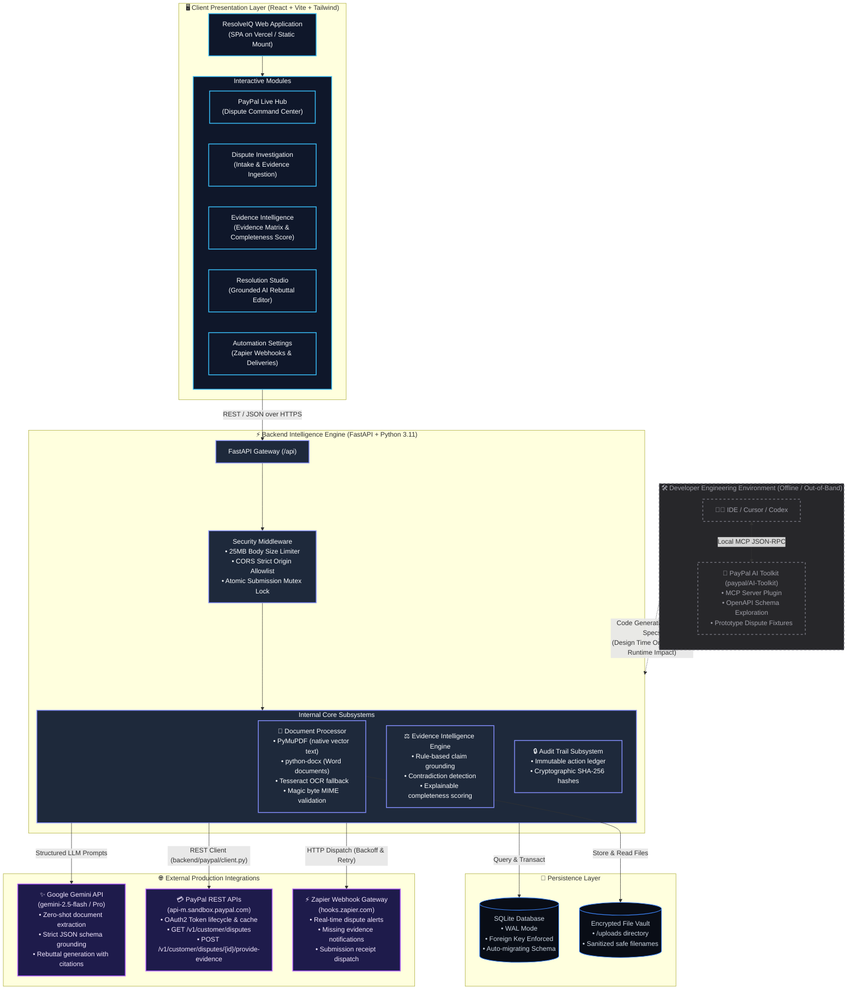
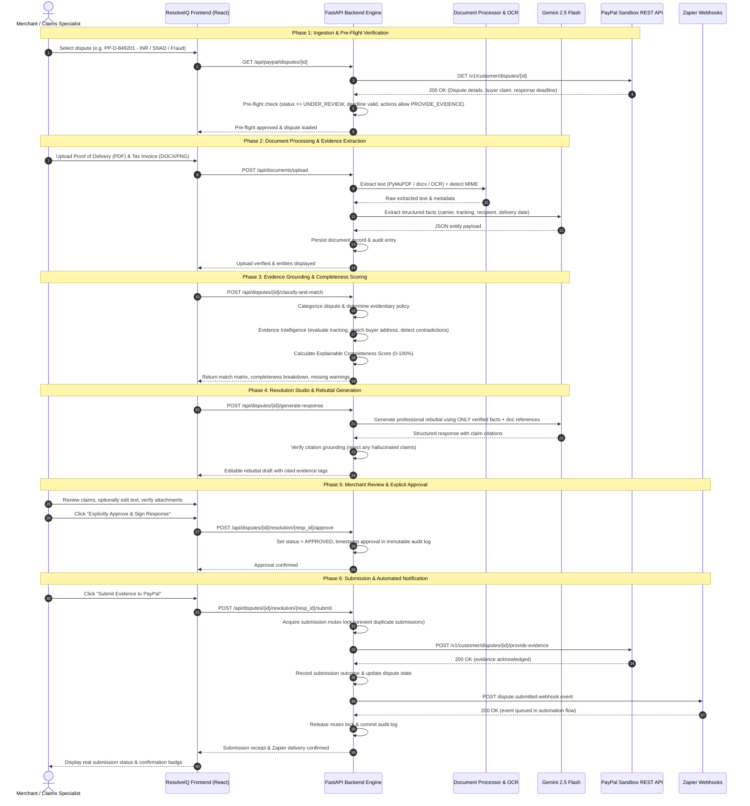

# ResolveIQ — Architecture & System Workflow Specifications

This document details the complete system architecture, data flow, integration boundaries, and end-to-end dispute resolution workflow for **ResolveIQ**.

---

## 1. System Architecture Diagram

---

## 2. End-to-End Dispute Resolution Workflow

